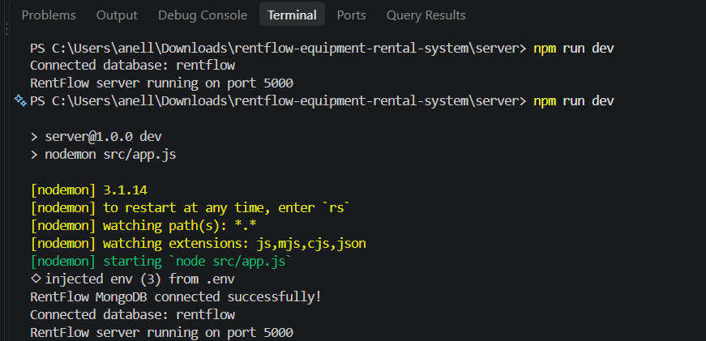
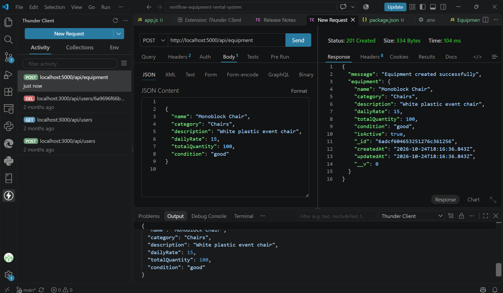
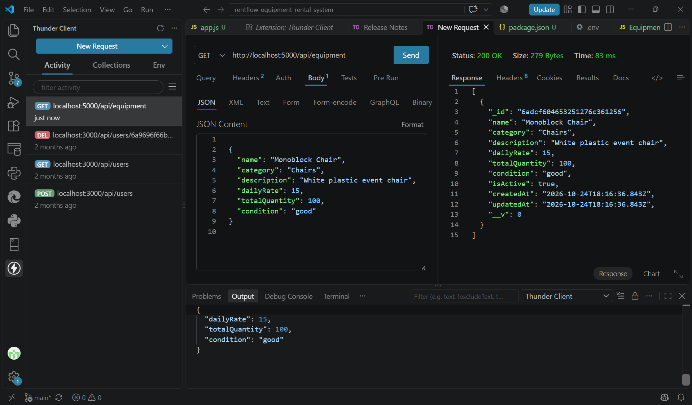
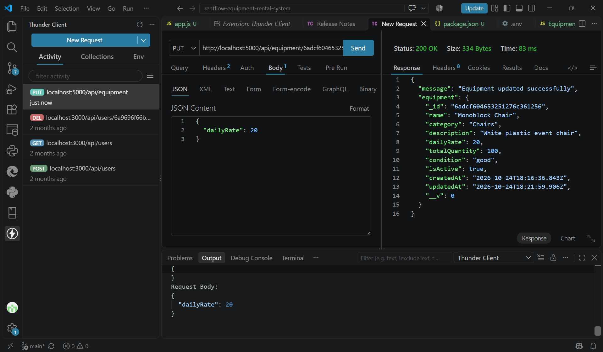
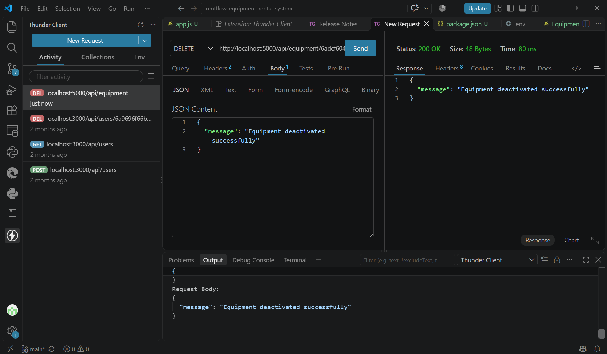
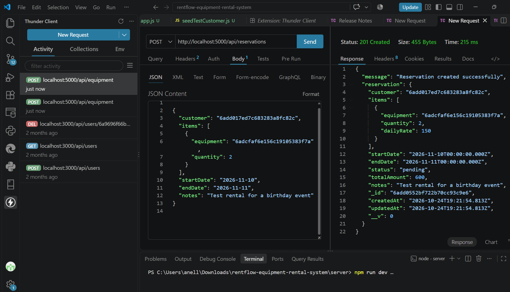
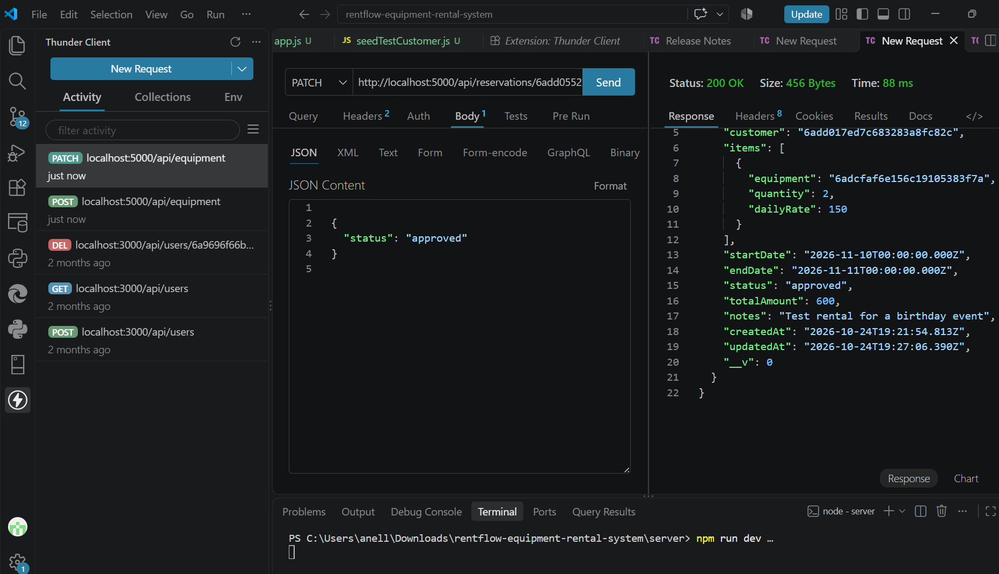
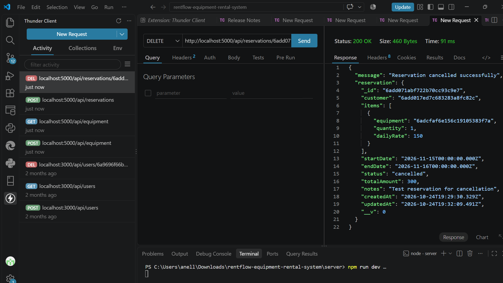
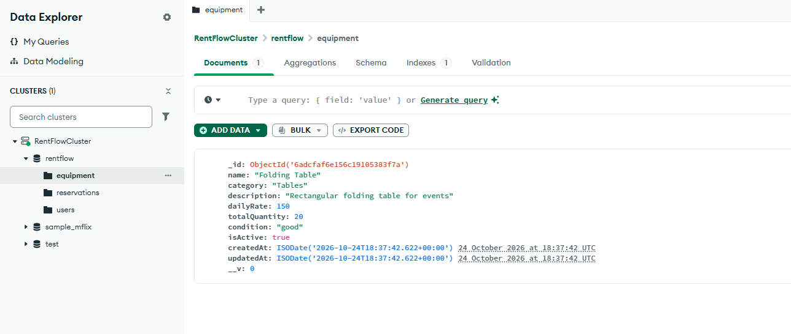
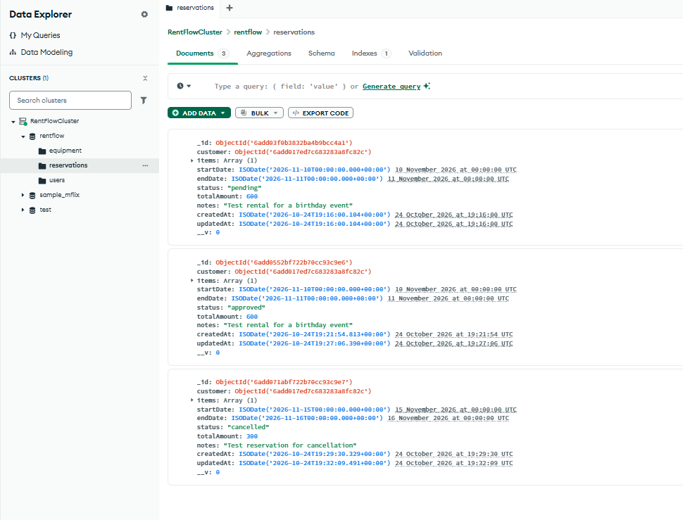

# RentFlow - Week 11 Development Progress

**Project Title:** RentFlow: A Web-Based Equipment Rental and Resource Management System
**Development Week:** Week 11
**Focus Area:** Backend API Setup
**Required Deliverables:** CRUD Endpoints and Mongoose Models

## 1. Objectives

The objective of Week 11 is to establish the backend foundation of RentFlow using Node.js, Express.js, MongoDB Atlas, and Mongoose.

The backend will manage equipment records, customer information, and rental reservations through RESTful API endpoints.

## 2. Technologies Used

| Technology | Purpose |
|---|---|
| Node.js | Backend JavaScript runtime |
| Express.js | REST API development |
| MongoDB Atlas | Cloud-hosted NoSQL database |
| Mongoose | Database schemas and models |
| Thunder Client | API endpoint testing |
| VS Code | Development environment |
| Git and GitHub | Version control |

## 3. Completed Development Tasks

- Initialized the backend project and installed the required dependencies.
- Configured the Express server.
- Established a successful connection to MongoDB Atlas.
- Created the Equipment, User, and Reservation Mongoose models.
- Implemented equipment CRUD operations.
- Implemented reservation creation, retrieval, status updates, and cancellation.
- Created a test customer for reservation testing.
- Tested API endpoints using Thunder Client.
- Verified equipment, reservation, and user records in MongoDB Atlas.

## 4. Database Structure

**Database Name:** `rentflow`

The database contains three main collections:

### Equipment

Stores information about rentable event equipment, including:

- Equipment name and category
- Description
- Daily rental rate
- Total quantity
- Equipment condition
- Active status

### Users

Stores customer and system user information, including:

- Full name
- Email address
- Hashed password
- User role
- Active status

### Reservations

Stores rental transactions and reservation information, including:

- Customer reference
- Equipment items and quantities
- Start and end dates
- Reservation status
- Total rental amount
- Additional notes

## 5. API Endpoints Tested

| Method | Endpoint | Purpose |
|---|---|---|
| GET | `/api/equipment` | Retrieve equipment records |
| POST | `/api/equipment` | Create equipment |
| PUT | `/api/equipment/:id` | Update equipment |
| DELETE | `/api/equipment/:id` | Delete or deactivate equipment |
| POST | `/api/reservations` | Create a reservation |
| GET | `/api/reservations/:id` | Retrieve a reservation |
| PATCH | `/api/reservations/:id/status` | Update reservation status |
| DELETE | `/api/reservations/:id` | Cancel a reservation |

*Endpoint paths should be checked against the final route files before submission.*

## 6. Testing Results

Equipment API testing successfully demonstrated create, read, update, and delete operations.

Reservation API testing demonstrated successful reservation creation, retrieval, status updates, and cancellation.

Thunder Client returned successful HTTP responses, including `200 OK` and `201 Created`.

MongoDB Atlas confirmed that the application stored equipment, user, and reservation documents.

## 7. Challenges Encountered

During backend development, the following issues were encountered:

1. MongoDB authentication initially failed because the database connection credentials required correction.
2. Equipment records were initially stored in the default `test` database instead of the intended `rentflow` database.
3. An Express route registration error caused the server to crash during reservation API setup.
4. Thunder Client temporarily reported a connection refusal when the backend server was not running.

These issues were resolved by correcting the environment configuration, selecting the intended database, fixing route registration, and restarting the development server.

## 8. Current Development Status

The initial backend foundation is operational. The Express server connects to MongoDB Atlas, and the tested equipment and reservation API operations work successfully.

Authentication, authorization, comprehensive input validation, and additional rental business rules remain to be implemented and tested.

## 9. Next Development Phase

**Week 12 — Frontend Scaffolding**

The next phase will focus on creating the React and Tailwind CSS frontend, setting up React Router, and developing the initial static pages.

Planned pages include the landing page, login page, registration page, dashboards, equipment catalog, and reservation interfaces.

## 10. Development Evidence

The following screenshots document the successful implementation and testing of RentFlow's backend API during Week 11.

### MongoDB Connection

### Equipment Management API

**Create Equipment**

**Retrieve Equipment**

**Update Equipment**

**Deactivate Equipment**

### Reservation Management API

**Create Reservation**

**Approve Reservation**

**Cancel Reservation**

### MongoDB Atlas Verification

**Equipment Collection**

**Reservations Collection**

### Testing Summary

The screenshots confirm successful basic API operations for equipment and reservations. Thunder Client returned the expected success responses, while MongoDB Atlas verified that the corresponding records were stored and updated in the database.
